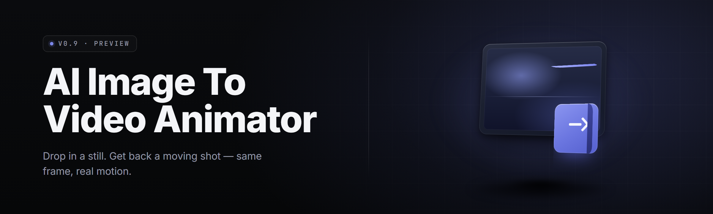

  
  
  

  

  
  

---

**AI Image-to-Video Animator** turns a single still image into a driven motion clip — no shot library, no rigging, no timeline algebra. Drop a photo, a render, or a frame grab, pick a motion preset, hit render, walk away with a video file. 2026 build.

---

## 🧱 The Problem

- Single-image animation tools want a **video driving clip** you don't have. You have one picture and a deadline.
- Diffusers repos assume CUDA, a Python env, and a research paper. You have a Windows box.
- Web demos **downscale, watermark, or cap clip length** the moment you look at the export button.
- Motion looks either frozen or boiling — parrallax, depth jitter, no idea which knob fixes which.
- Presets that ship with one motion type for every subject. Walk for a face. Smile for a landscape.
- Output codecs gobbled by nothing — no H.264, no ProRes, no clean alpha.
- Rerun for one frame you liked and you get a **completely different seed**, different luminance, different everything.

## 🩹 Known Issues

| Issue | Fix |
|---|---|
| Render hangs on 4K source frames | Cap source to 2048px or lower; denoiser VRAM estimate runs hot above it |
| Output shows a 1-frame flash at start | Enable *Anchor First Frame* — preset drives frame 1 with structure, not noise |
| Motion feels floaty / ice-skating | Lower **Motion Strength** below 0.4 and raise **Depth Lock** to 0.7 |
| CUDA OOM on 8GB cards | Drop to `balanced` node group and clip preview to 640px |
| Face region warps during camera pans | Enable *Face ROI Stabilizer* before the motion node attaches |

---

## 🎞️ Overview

| Category | Details |
|---|---|
| Input types | PNG, JPG, WEBP, EXR, TIFF (single frame) |
| Motion sources | Text prompt, camera preset, latent drift |
| Max resolution | 4096×4096 source, 1920×1080 clip output |
| Inference runtime | 4–40 s / 2 s clip (GPU dependent) |
| Render backends | CUDA 12.x, DirectML fallback |
| Output container | MP4 (H.264/H.265), WebM, ProRes 422, PNG seq |
| Preset library | 31 shipped, user-importable |
| Batch mode | Folder queue with stable seed inheritance |

Built as a local-first treatment — no login, no clip-length ceiling by account tier, works with the file manager you already have.

## 🔤 What is Image Animation with Motion Transfer?

| Term | Explanation |
|---|---|
| **Still frame** | Your source image before anything moves. Structure, colour, and depth here all affect the result. |
| **Motion prompt** | A short text string spec describing how to drive the frame — the language side of the pipeline. |
| **Latent drift** | Estimating the movement vector along the frame's implied depth cue instead of explicit camera rotation. |
| **Depth Lock** | A per-frame parallax multiplier that pins near-plane objects so they don't slide under camera moves. |
| **Anchor frame** | The frame held under structural conditioning so motion doesn't destabilize the source composition. |
| **Preset stack** | A named ordered set of motion + timing + codec instructions shipped as a JSON package. |
| **Node graph** | The render pipeline expressed as wiring — each stage is a module you can bypass or reorder. |

## 📊 Comparison

| Aspect | Single-shot cloud demo | General video diffusion stack | This Tool |
|---|---|---|---|
| Install path | Browser tab + account | Python env, CUDA, months of docs | Extract, run `.exe` |
| Pricing model | Credit per clip | Free but you'll spend a weekend | Local, offline, no per-clip meter |
| Motion control | One "motion strength" slider | Raw diffusers tensors | 9 named motion params |
| Max resolution | Capped at 720p | 512×512 native | 1920×1080 native, 4K source |
| Seed reproducibility | Opaque | Reproducible if you wrote the script | Named sidecar file, hash-verifiable |
| Composition preservation | Prompt's mercy | Manual conditioning mask | ✅ Anchor Frame default-on |
| Offline | No | Yes if you built it | ✅ No network calls after install |
| Export options | One codec, watermarked | Whatever ffmpeg mux you wrote | 6 containers, no watermark |

---

## 📖 Table of Contents

- [What it does](#-what-it-does)
- [Key Features](#-key-features)
- [Feature Modules](#-feature-modules)
- [Compatibility](#-compatibility)
- [Tips for Best Results](#-tips-for-best-results)
- [Quick Start](#-quick-start)
- [Installation](#-installation)
- [Post-Render Control Loop](#-post-render-control-loop)
- [System Requirements](#-system-requirements)
- [FAQ](#-faq)
- [About](#-about)

## 🎬 What it does

You hand it an image. You hand it a motion description. It hands back a clip where everything that made the still good is still there, and everything that moves moves on purpose.

That's four operations in one process: **structural conditioning** to preserve layout, **motion estimation** from either a text prompt or a preset vector, **temporal synthesis** across however many seconds you asked for, and **codec multiplexing** into a container your editor already accepts.

## ⚙️ What is the Animator — setup in plain terms

1. Launches as one `.exe`. No installer, no admin prompt beyond the DirectX redists Windows asks for on a fresh machine.
2. On first run spawns a local config directory next to the binary: presets, seeds, cached model weights, log files.
3. Loads the default motion node (12 GB working set on GPU, 6.5 GB on DirectML fallback).
4. Presets are JSON — hand-editable, comment-free, diff-friendly, shareable.
5. Every render writes a sidecar containing source hash, parameters, seeds, so a clip can be reproduced exactly.

**Why this matters for stills:**

- Reproduces composition — you don't lose the shape of the frame you spent an hour on.
- Controls motion independently of style.
- Reverses and re-renders parts of a clip without redoing the whole thing.
- Keeps output containers acceptable in Premiere, Resolve, and Blender's VSE without a mux step.

## 🚀 Key Features

| Feature | Description | Benefit |
|---|---|---|
| Anchor Frame | Pins the source composition through the first conditioning layer. | Motion doesn't lose your framing. |
| Depth Lock | Slider controlling near-plane parallel scroll during camera moves. | Landscape shots stop sliding off-screen. |
| Motion Presets (31) | Named vectors for common movement — dolly, orbit, crane, breathe, drift. | No writing prompts for the same shot twice. |
| Node Bypass Tree | Toggle any pipeline stage live in the run window. | Debug "why is it boiling" in ten seconds. |
| Seed sidecar | Parameters + source hash written alongside every output. | Hash-for-hash regeneration of any clip. |
| Face ROI Stabilizer | Keeps facial region geometry attached during motion. | Pans no longer stretch the subject. |
| Prompt Reuse Library | Save+tag short motion prompts by shot type. | Faster cadence on long sequences. |
| Watch Folder | Drop images into a directory, clips come out. | Unattended batch render. |
| Four-tier resolution presets | 480p → 1080p → 1440p → 1080p hi-fidelity. | Render speed matched to delivery. |
| DirectML fallback | Runs without CUDA, slashed through DirectML. | Ships to machines without a green card. |

---

## 🧩 Feature Modules

**Image intake** — validation, EXIF strip, colourspace contract, canvas normalization.

**Structure** — anchor frame, edge guide graph, depth inference, contour preservation mask, region weighting.

**Motion** — text motion prompt parser, preset vector library, forward/backward drift estimator, camera pan/tilt/roll stack, breathing cycle, parallax weighting, depth lock.

**Synthesis** — latent temporal transformer, denoise schedule with cfg override, context window relay (handles clips over 6 s), rolling seed stabilization.

**Face / Detail** — face ROI geometry anchor, eye-region temporal lock, edge guided refinement pass, high-frequency reattachment using structural soft reset.

**Batch / Queue** — watch folder listener, queue file, per-image parameter overrides, crash-recovery resume, historical outputs indexer, stable-tier re-render check.

**Output** — MP4 multiplexer (H.264 / H.265), WebM, ProRes 422 proxy, PNG sequence with alpha, motion-data report JSON, per-frame quality tag file, frame rollback.

**Meta** — node graph editor for the pipeline, motion param scratchpad with named slots, portable preset export, debug hex estimator, VRAM guard.

- **Canvas adapters** — four output aspect targets (16:9, 9:16, 1:1, 4:5) with automatic content-anchored letterbox.
- **Temporal denoising override** — three-day cfg schedule in a single JSON.
- **First-frame blender** — fades motion amplitude in over n frames to avoid cut-from-noise opening.
- **Clip health check** — reports compression-timing pulses, black-frame edges, and gross frame deltas.
- **Motion-magnitude mask** — paint a region to lock or exaggerate motion locally.
- **Progressive export** — play the muxer during render instead of after.

## 🧪 Compatibility

| Platform | Status | Notes |
|---|---|---|
| Windows 10 x64 (22H2+) | ✅ Supported | Primary target |
| Windows 11 x64 | ✅ Supported | Primary target |
| Windows Server 2022 | ⚠️ Partial | No GPU scheduler priority tuning |
| WSL2 pass-through | ⚠️ Partial | Renders, but you're back to configuring more than you wanted |
| Linux native build | ❌ Not shipped | —
| macOS | ❌ Not shipped | DirectML path not ported |

## 🧠 Tips for Best Results

- Keep source frames single-input, single-output. Ten megapixel captures go through unchanged; extreme pano aspect ratios will draft into rule-of-something framing.
- Set **Anchor Frame** on for architectural interiors. Trust it enough to leave the slider flat at default.
- Motion prompts like `slow dolly in, slight billow` outperform long sentences. Short nouns and camera vocabulary.
- Zero the **Drift Amplitude** if you need every pixel traceable between frames — legal, archival, or product-def photo.
- Test at 480p before committing a 1080p queued batch of eighty.
- Save preset bundles to `presets/` next to the `.exe`. Sync that directory and you keep the same library across machines.

## 🐚 Quick Start

1. Grab the release from the landing page and extract the archive somewhere with 25 GB free.
2. Double-click the `.exe`. Accept the redist prompt if Windows asks.
3. Open the **Motion** tab, load an image, then select a preset from the left bar (start with `03-dolly-in`).
4. Name the output, choose a resolution tier, and click **Render**.
5. When the progress overlay closes, the clip is in `output/` with a matching sidecar.

  

## 🪄 Installation (the long-form version, same idea)

1. **Extract.** Windows Defender may hesitate on an unsigned `.exe`. Trust it locally, or right-click → *Properties* → *Unblock first*. The archive extracts in place, model weights unpack on first launch.
2. **Configure VRAM tier.** Choose `balanced`, `quality`, or `low-vram` in first-run setup. Defaults to `balanced` and auto-detects free VRAM. Change anytime in *Settings → Inference*.
3. **Pick output root.** Global default is `output/` relative to the `.exe`. Override per-project, per-render, or globally before you forget.

## 🎚️ Post-Render Control Loop

Single-frame rollback exists deliberately. You render, you watch, you find the three seconds where the camera went tooth-slip.

Click a rendered clip, scrub **frame-number**, and right-click the offending window. The pipeline re-renders just that slice, pinned to frame `n` from existing clip, with your current params, and it puts the boundaries back into the previous mux sequence. Save the resulting after a single render. No redo of everything.

| Shortcut | Action | Scope |
|---|---|---|
| `Space` | Play / pause preview | Render window |
| `←` / `→` | Step one frame | Preview timeline |
| `Range-Select + R` | Re-render selected frame range | Clip |
| `S` | Save current params as preset | Global |
| `Alt+S` | Save preset variant | Global |
| `L` | Toggle locked region mask | Canvas |
| `1`–`9` | Swap stored param slot | Motion panel |
| `Alt+T` | Copy params as JSON to clipboard | Global |

## 💻 System Requirements

| Component | Minimum | Recommended |
|---|---|---|
| OS | Windows 10 x64 22H2 | Windows 11 x64 24H2 |
| CPU | Quad-core x64, AVX2 | 8-core x64, AVX-512 |
| RAM | 8 GB | 16 GB+ |
| VRAM | 6 GB (DirectML path) | 12 GB+ CUDA |
| GPU | Any DirectX 12 D3D12 device | NVIDIA RTX 30-series+ |
| Storage | 25 GB SSD/HDD | 20 GB NVMe free after install |
| Runtime | DirectX 12, VC++ 2015–2022 redist | CUDA 12.x runtime |

## ❗ FAQ

| Question | Answer |
|---|---|
| Will it run without an NVIDIA card? | Yes — the DirectML path is default fallback. Slower, still produces the same containers. |
| Does anything phone home? | No network calls after install. Preset sync is your file manager's job. |
| Can I reproduce a clip exactly later? | Yes — every render writes a sidecar with source hash, params, and seeds. |
| How long can a generated clip be? | 12 s at 1080p, 30 s at 1024×648; longer through chained passes. |
| Can I use a driving video? | Not in v2.x. The motion sources are text, preset, and latent drift. |
| Does it preserve the original composition? | Default conditioning is Anchor Frame; switch off explicitly if you mean to. |
| What model does it actually use under the hood? | A renamed temporal transformer — weights ship with the archive, listed in `meta/`. |
| Will DirectML look identical to CUDA? | Same settings produce visually equivalent clips; parity is not frame-hash-identical. |
| Where do presets live? | `presets/` next to the `.exe`. Plain JSON, one file per preset. |
| How much VRAM for 1080p hi-fi? | 12 GB comfortable, 10 GB with `low-vram` tier. |
| Can I run two renders at once? | No — one render process per machine, watch folder is the concurrency path. |
| Can I install it to a drive that isn't C:? | Yes, and you should — everything lands where the `.exe` sits. |

## 🥔 About

**AI Image-to-Video Animator** is a *local-first* still-animation tool for the shot-archive crowd: engineers repurposing a render, micro-narrators who live on one good frame, VFX heads who need a two-second billow shot before the dailies review.

Consider its single-file export a mission rather than a checkbox. Everything else is somewhere in the node tree, accessible without a rebate. If an AI VM solves your problem your pipeline already round-tripped through before, good — the plain-framed wait time shouldn't cost a login. Absolute potato off of that. The only requirement left is a decent source frame.

  

